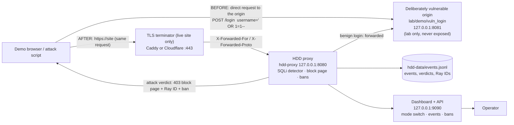

# HK1 demo: blocking SQL injection on a login page (10-minute rehearsal script)

This is the exact script for the Hackathon HK1 demo: **without HDD the SQL injection
on the login page reaches the admin area; with HDD the same request is blocked, gets a
Ray ID and bans the sender.** Rehearse it end-to-end against the local lab origin
before pointing anything at the operator's site.

**Honesty box (read before presenting).**
- What the demo shows is a *local rehearsal* on one machine with a deliberately
  vulnerable lab app. It demonstrates the HDD SQL-injection detector, the block page,
  the event record and the ban. It is **not** a claim that any live site is "fully
  protected" or "secure": a virtual patch does not fix the origin (R-11) and a site
  is not protected while the origin can be reached directly (R-34).
- A live site only counts as protected once **all** of these hold and are checked in
  front of the operator: the proxy is in `block` mode, the origin refuses direct
  requests (firewall allow-list of the proxy IP) or enforces the origin secret
  header, and the verification flow shows the request blocked through the public
  hostname with a Ray ID. Until then say: *"HDD is in front of the site; the origin
  lockdown is still to be verified."*
- All attack-shaped traffic in this demo goes to loopback (`127.0.0.1`) or to a host
  the operator listed in `lab/demo/targets.allow`. Never to a third party.

---

## Where each part runs

| Part | Process | Address (local rehearsal) | Notes |
| --- | --- | --- | --- |
| Vulnerable origin ("without HDD") | `lab/demo/vuln_login/app.py` (Python 3 stdlib + sqlite3) | `http://127.0.0.1:8081/login` | Lab-only, loopback-only, intentionally vulnerable, **must never be exposed** |
| HDD proxy (+ SQLi detector) | `crates/hdd-proxy` built by `cargo build -p hdd-proxy` | `http://127.0.0.1:8080` (default; the launcher prints the run endpoint) | Config `demo/hdd-dev.yaml`: site `127.0.0.1` -> origin `127.0.0.1:8081`, mode `block`; see the port fallback note below |
| Dashboard / admin UI | part of the same `hdd-proxy` process (admin listener) | `http://127.0.0.1:9090/` (default; printed by the launcher) | First run shows `/setup`; bearer cookie from the dev token |
| Event log + bans | `hdd-data/events.jsonl`, in-memory ban list | - | `hdd-data/` is git-ignored; bans reset when the proxy restarts |
| TLS terminator (live site only) | Caddy or Cloudflare in front of the proxy | `https://<domain>` -> `127.0.0.1:8080` | Example: [`deploy/Caddyfile.example`](../deploy/Caddyfile.example); TLS is not in the proxy for HK1 |
| Operator's real origin (live site only) | the site itself | e.g. `https://origin.example.com` or `https://project.vercel.app` | Locked down per [`deploy/origin-lockdown-nginx.conf.example`](../deploy/origin-lockdown-nginx.conf.example) or the Vercel secret header (see below) |

The local stack is started by `npm run dev` (one terminal, prefixed colour logs,
Ctrl+C stops all children). `npm run demo` starts the same stack and runs the four
scripted observations automatically.

### Endpoints and the per-run port fallback

The committed profile `demo/hdd-dev.yaml` keeps its documented endpoints: proxy
`127.0.0.1:8080`, admin `127.0.0.1:9090`. If one of those ports is already taken on the
machine (on the HK1 build machine **TCP 8080 is held by MiniTool ShadowMaker's
`MTAgentService`**, so a bind attempt fails with WinError 10013), `npm run dev` does not
edit the committed file: it probes the configured ports, writes a generated profile for
that run at `hdd-data/dev.generated.yaml` with `listen`/`admin_listen`/`public_url`
substituted, starts the proxy with it, and prints ONE line, for example the observed:

    [hdd] port 8080 unavailable (held by another process); using proxy http://127.0.0.1:18080 and admin http://127.0.0.1:19090 for this run - the committed demo/hdd-dev.yaml keeps 8080/9090

From then on, **use the URLs printed in the READY banner**, not the default port numbers
in this document. `npm run attack` reads the endpoints of the last `npm run dev` run from
`hdd-data/dev-endpoints.json`, so it targets the right proxy automatically (with
"through HDD" semantics). The fallback pairs tried are 18080/19090, then 18081/19091, ...
(the launcher also verifies the admin listener on the pair's admin port).

## Architecture (one page)



The BEFORE arrow is the vulnerability: the payload reaches a real
string-concatenated SQL query and the admin page opens. The AFTER path never reaches
the origin when the SQL injection is detected: the proxy answers with the block page
and records the event and the ban.

## Pre-flight (2 minutes before the demo)

1. `npm run dev` (needs Node 18+, Rust/cargo, Python 3; the launcher checks them and
   prints an actionable error instead of half-starting).
2. Copy the randomly generated lab credentials from the banner (they change on every
   start; the admin password is also visible in the `[vuln ]` log line).
3. Open the dashboard URL printed by the launcher (default `http://127.0.0.1:9090/`
   unless a fallback pair is active). First run: create the owner account at `/setup`
   (min 12-character password); if `/setup` returns 404 an owner account already exists,
   so sign in instead. The admin bootstrap token is in `hdd-data/dev-admin-token.txt`
   (dev only, local only, git-ignored) if the login form asks for it.
4. Confirm the site card says mode **block** (fix it in the dashboard if it does not).
5. Keep this page open next to the terminal. Have `docs/DEMO.md` (this file) ready.
6. Optional dry run: `npm run demo` (starts the stack, runs the four scripted checks,
   leaves the stack running). The full walkthrough makes real loopback requests.

## The 10-minute script

Times are cumulative from the start of the demo.

### 0:00-1:30 - Frame it honestly (90 s)

> "This is a web application firewall slice for protecting one login page against SQL
> injection. I will show the same attack twice: first straight at the vulnerable app,
> then through the HDD proxy. The claim I can support today is narrow: on this local
> rehearsal stack, HDD detects and blocks the SQL-injection payloads, shows a block
> page with a Ray ID, records the event and bans the sender. I will also show what is
> still missing before this could protect a production site."

### 1:30-3:00 - BEFORE: the SQL injection reaches admin (90 s)

1. Open `http://127.0.0.1:8081/login` (direct to the vulnerable origin, no HDD).
2. In the username field type: `' OR 1=1--` and any value in the password field,
   submit. The app logs the SQL it executed (`SELECT ... WHERE username='' OR 1=1--' ...`)
   and the **Admin panel opens**.
3. In the terminal, run the direct measurement (adds the per-payload table and the
   six auth-bypass forms):

   ```bash
   npm run attack -- --target http://127.0.0.1:8081
   ```

   Real expected line (verified on this stack):
   `direct origin: reached admin POST 8/12, GET 8/12 (24 requests in ~12 s; 500 ms spacing ...)`.
   Direct explanation: the six mandated payloads M1, M2, M3, M5, M6 reach the admin
   page; M4 `admin' #` does not (SQLite has no `#` comment syntax: `unrecognized
   token "#"`). Of the auth-bypass forms B1, B2, B6 reach admin; B3 fails (extra
   parentheses this query shape lacks), B4 fails (`#` again), B5 runs but matches no
   row. This is expected and documented: spec `docs/SPEC.md` E1.1/P28 record that some
   mandated payloads are dialect-invalid on a given endpoint. HDD's job is to block
   them by *intent*, including the dialect-invalid ones.

### 3:00-5:00 - AFTER: the same request through HDD (120 s)

1. Open the through-HDD URL printed by `npm run dev` at `/login` (default
   `http://127.0.0.1:8080/login`; mode block). Repeat the same
   `' OR 1=1--` login. The proxy returns the **block page**: "Access denied / Your
   request looked like an attack ... / Reference: <Ray ID>". Note the Ray ID.
2. In the terminal (through the proxy, all twelve payloads):

   ```bash
   npm run attack   # uses the proxy URL of the last `npm run dev` run
   ```

   Expected: every one of the 12 payloads (M1-M6 + B1-B6, POST and GET) gets HTTP 403
   and a block page/Ray ID; the summary says
   `through HDD: blocked POST 12/12, GET 12/12` and `Ray IDs seen: N`. The source
   (`127.0.0.1`) is now **banned**: an immediately following benign request also gets
   403 until the ban expires (TTL ladder in `demo/hdd-dev.yaml`: 60 s, 600 s, 3600 s).
3. In the dashboard: the **blocked event** appears in the live feed/events table with
   time, client IP, rule id, category `sqli`, vector (form body/query), field and the
   redacted evidence, plus the Ray ID; the **Bans** page lists the source with the
   reason and the TTL countdown. Open the event row detail to show *why* it was
   blocked (explainable bans, R-24).

### 5:00-6:30 - Live contrast: protection off, then back to block (90 s)

The ban currently applies to the demo source, so first remove it: dashboard -> Bans ->
**Unban** `127.0.0.1` (or restart `npm run dev`, which clears in-memory bans).

1. Dashboard -> site card -> switch mode to **off** (destructive-ish switch: confirm if
   the UI asks). Repeat the `' OR 1=1--` login through `http://127.0.0.1:8080/login`:
   the admin panel opens, i.e. the proxy is now a pure pass-through. Say clearly: *"in
   `off` mode HDD protects nothing."*
2. Switch back to **block**. Repeat the same login: block page with a new Ray ID, new
   event, source banned again.
3. (Optional, if time) switch to **monitor**: legitimate users are not blocked but the
   event is recorded as "would block". This is the safe rollout mode.

### 6:30-8:00 - Why the verdict is explainable (90 s)

In the event row detail show: the injected field (`username`), the detected family
(quote break-out + tautology/comment), the rule id, the redacted evidence snippet (at
most 128 bytes) and the Ray ID. Then point at the site config: the login form fields
are declared as `username`/`password` in `demo/hdd-dev.yaml` (`field_hints`), which is
what lets the detector apply the right context policy. Emphasise: detection works on
the request *intent*, so it also blocks the dialect-invalid M4/B3/B4/B5 payloads that
cannot even exploit this particular SQLite app.

### 8:00-9:30 - Honest limits and the live-site path (90 s)

Say what this does **not** show (see the full list below): no TLS inside the proxy, no
L3/L4 DDoS protection, no protection while the origin is directly reachable, one site,
one detector family, local lab app. Then the live-site checklist items this demo
proves are *not* yet verified on the operator's site, and what the operator must
provide (see "Live-site details still needed"). Phrase the status as: *"locally
rehearsed; on the live site the remaining step is the origin lockdown plus the
verification run."*

### 9:30-10:00 - Close (30 s)

> "Without HDD the injection logged in as admin. Through HDD in block mode the same
> request was refused with a Ray ID and the sender was banned, with the reason recorded.
> The origin application is still vulnerable and needs the real fix; HDD is the
> virtual patch in front of it."

## Exact commands and buttons (appendices)

```bash
npm run dev                          # stack: lab origin, proxy, dashboard (prints the URLs)
npm run demo                         # same stack + the four scripted observations
npm run attack -- --target http://127.0.0.1:8081   # BEFORE (direct origin): reached admin
npm run attack                       # AFTER (through HDD): blocked + banned (uses the dev run endpoints)
npm run test                         # node launcher tests + cargo fmt/clippy/nextest
npm run lint                         # node syntax + lab app syntax + cargo fmt/clippy
```

`attack.ps1` directly (Windows PowerShell 5.1 or 7): `powershell -NoProfile
-ExecutionPolicy Bypass -File lab/demo/attack.ps1 -TargetUrl http://127.0.0.1:8081`
(optional `-LoginPath /login -UserField username -PassField password
-Kind auto|direct|proxy|target`). The bash twin: `lab/demo/attack.sh --target <url>`.

Both scripts:
- refuse a non-loopback target that is not listed in `lab/demo/targets.allow`
  (operator-created, one host per line; loopback is always allowed);
- send only the 12 catalogue payloads to the login endpoint (no scanning, no other
  paths, no other attack classes), rate-capped at 2 req/s;
- print every request with its status and whether it looks like the admin page, then
  the final "reached admin / blocked yes/no per payload" table;
- exit code 0 when the run was executed (the table is the result, even when nothing
  was blocked), 2 usage/prerequisite, 3 refused by the allowlist, 4 invalid target,
  1 only when every request failed at transport level.

## Reset / rehearse again

- Restart `npm run dev`: the proxy restarts with empty in-memory bans; the lab origin
  regenerates its random seed passwords.
- Or unban the source from the dashboard Bans page and set mode back to `block`.
- If the browser starts getting 403s through 8080 after the attack script ran, the
  source is banned: unban it (the dashboard on 9090 is a separate listener and is not
  affected by site bans).

## Rehearsed evidence on the HK1 build machine (2026-10-23)

Real console lines from one rehearsal run (Windows, PowerShell 5.1, Node 24, cargo
1.98.1, Python 3.14.6; port 8080 held by MiniTool ShadowMaker):

- `npm run dev`: `[hdd] port 8080 unavailable (held by another process); using proxy http://127.0.0.1:18080 and admin http://127.0.0.1:19090 for this run - the committed demo/hdd-dev.yaml keeps 8080/9090`
- proxy child log: `[proxy]   site 127.0.0.1 -> http://127.0.0.1:8081 mode block strictness Balanced`
- `npm run attack` (through HDD, auto endpoints): `through HDD: blocked POST 12/12, GET 12/12 (24 requests in 11.7 s; 500 ms minimum spacing ...)`, `Ray IDs seen: 24`
- `npm run demo`: `[walkthrough] 4/4 observations PASS (these are local loopback runs, not a claim about any live site).` with real lines: benign seeded login through HDD HTTP 200; M1 direct HTTP 200 admin; M1 through HDD HTTP 403 Ray ID `cb8b2eeabcc4c620-HDD1`; next benign request HTTP 403 (ban active)
- `npm run attack -- --target http://127.0.0.1:8081` (direct origin): `direct origin: reached admin POST 8/12, GET 8/12 (24 requests in 11.8 s; ...)`, with the M4 dialect note
- Ctrl+C: `[hdd] Ctrl+C received: stopping children cleanly ...`, `[hdd] proxy stopped`, `[hdd] lab origin stopped`, `[hdd] stack stopped. Nothing is listening on the demo ports any more.`
- dashboard/admin listener: `GET /` 200, `GET /healthz` 200; `GET /setup` 404 when an owner account already exists (expected)

## Review round 1 fixes (2026-10-23)

An independent review probed the detector and the proxy after the first freeze; the
findings and their outcomes are in `docs/COLLAB.md` ("review of HK1 (round 1)"). The
items below were fixed and verified by the owners' red-to-green tests; nothing here
claims a fix that is not in the tree, and what remains is listed under Known
limitations.

- **Truncation fails open (HIGH).** Any inspection cap hit now returns a Block instead of
  an Allow (`category "policy"`, `subtype "truncated"`, rule `LIMIT-001`; 403 in block
  mode, `would_block` in monitor mode), so a payload is not silently allowed behind a
  value cap.
- **Quadratic detector cost (HIGH).** The quote-break-out, comment and duplicate-name
  paths were made linear with an operation budget; `inspect` runs on the blocking pool
  with a deadline and fails closed when the budget or the deadline is exceeded.
- **Review payload shapes (MEDIUM).** The blind/tautology shapes listed in the review now
  block: unknown-field numeric tautologies (`1 OR 1=1`, `1 or 2>1`, `0x31=0x31`,
  `'-0-'`, `CASE WHEN`), id-field `ORDER BY n`, `ASCII(SUBSTRING(...))`,
  `SUBSTR(user(),...)`, `(SELECT 1)=1`, `EXISTS(SELECT ...)`, and quote break-out followed
  by `(SELECT`.
- **Spoofed `Sec-Fetch-*` (MEDIUM).** Sending `Sec-Fetch-Site: cross-site` with
  `Sec-Fetch-Dest: image` no longer suppresses a ban; the request is still blocked. A
  cross-site subresource only lowers the ladder weight.
- **Slow clients and connection cap (MEDIUM).** The proxy enforces a 5 s header-read
  timeout and a 5 s body-read deadline (branded 408) and accepts at most 256 concurrent
  connections (opaque 503 above that).
- **Forwarding headers (MEDIUM).** `Forwarded`, `True-Client-IP`, `CF-Connecting-IP`,
  `X-Client-IP`, `X-Original-URL`, `X-Rewrite-URL` and `X-Forwarded-Port` are also
  stripped before the upstream request.
- **Admin listener (MEDIUM).** A non-loopback `admin_listen` is refused unless the config
  explicitly sets `admin_non_loopback_ack: true` (a warning is logged when it is set);
  the committed default stays loopback.
- **Content-Encoding (MEDIUM).** A request with a non-identity `Content-Encoding`
  (gzip/deflate) is refused (`policy`/`unsupported_content_encoding`, rule `CE-001`); the
  body is not decoded and is not passed through uninspected.
- **Over-cap bodies (MEDIUM).** In monitor mode the full body is forwarded and the event
  records `would_block`/`truncated` (only the first 256 KiB is inspected); in block mode
  the request keeps getting the branded 413 page.
- **Origin base path (MEDIUM).** An origin URL with a base path now has it prefixed on the
  upstream request path.
- **LOW items fixed as well:** sessions have a 24 h absolute expiry on top of the 8 h
  idle expiry; the login-failure map is capped at 4096 IPs; the block page no longer has
  literal backslash-n artefacts and security headers are single/proxy-owned; the client
  `Content-Length` is dropped and hyper sets it; ban/offence pruning runs on a 60 s timer
  (unit-tested); IPv6 bans are keyed per /64 (coarse, see Known limitations); JSON object
  keys, multipart `filename*`, a multipart boundary mismatch (`policy`/`boundary_mismatch`,
  rule `MP-001`) and all header values (8 KiB cap) are inspected; the quoted-words prose
  cases `q='a' or 'b'` and `I said 'no' or 'yes'` no longer hard-block under Balanced
  (Paranoid keeps them blocked).

## Known limitations (state them; do not hide them)

1. **Local rehearsal, not a live protection claim.** All evidence above is from
   loopback on one machine with the deliberately vulnerable lab app.
2. **No TLS inside the proxy (HK1).** It runs behind a TLS terminator (Caddy or
   Cloudflare); see `deploy/Caddyfile.example`. In the local stack everything is HTTP
   on loopback. HTTPS-origin forwarding (rustls with native roots) has no test against a
   real TLS origin in this environment: UNVERIFIED(no_tls_origin_test). TLS termination
   stays out of scope for HK1 by design.
3. **The origin stays vulnerable.** SQL injection is a bug in the origin application;
   HDD blocks the request, it does not patch the code (R-11: a virtual patch is not a
   fix). The site is not "fixed", only shielded.
4. **A site is not protected while the origin is directly reachable** (R-34). Locally
   `http://127.0.0.1:8081` is intentionally open so the demo can show the contrast. On
   a live site the origin must refuse non-proxy requests, and that state must be
   verified, not assumed.
5. **One detector family, one vertical slice.** HK1 covers SQL injection on a login
   page (plus the 12-payload catalogue). XSS, RCE, LFI, NoSQL injection, file uploads,
   authentication attacks beyond the login form, rate limiting and L3/L4 DDoS are out
   of scope for this demo.
6. **SQLite dialect nuance in the lab app.** Directly, M4 (`admin' #`) is a SQL error
   on SQLite; B3/B4 are SQL errors and B5 matches no row. M5/B6 bypass because SQLite
   treats an unterminated `/*` as a comment to end of input. Through HDD all 12 are
   blocked by intent. This is documented per `docs/SPEC.md` E1.1/P28, not hidden.
7. **Ban state and counters are in memory** (events are logged as JSONL in
   `hdd-data/`). A proxy restart clears bans and counters; there is no durable ban
   database in HK1.
8. **Single site, single node, no HA.** The local config has one site; no failover, no
   multi-node, no persistence of the admin state beyond the local data directory.
9. **Request-body cap and no response inspection.** Request bodies are inspected up to
   256 KiB. In `block` mode a request whose body cannot be inspected inside that cap is
   refused with the branded 413 page; in `monitor` mode the full body is forwarded and the
   event records `would_block`/`truncated` (only the first 256 KiB is inspected).
   Responses are not inspected in HK1.
10. **The demo's own source address is loopback.** The attack script and the browser
    share `127.0.0.1`, so a ban after the attack affects both; unban before browser
    steps (see "Reset").
11. **The npm launchers are developer convenience**, not product code: they build
    with cargo and run the same binary the hosted profile uses (no DEV_MODE), but they
    are not part of a release and do not replace the Rust gates.
12. **Windows PowerShell 5.1 note:** `attack.ps1` is 5.1-compatible and drives
    `curl.exe` (present on Windows 10 1803+/11) for cookie/redirect handling; the bash
    twin uses `curl`. Install curl on older Windows or use WSL/Linux.
13. **No email, no external services, no telemetry.** The local stack makes no
    outbound internet connection; the only network traffic is loopback.
14. **Endpoint fallback.** If proxy port 8080 or admin port 9090 is held by another
    process, `npm run dev` uses a generated per-run profile under `hdd-data/` with a
    fallback pair (18080/19090, then 18081/19091, ...) and prints the URLs. The committed
    `demo/hdd-dev.yaml` keeps 8080/9090; in fallback runs use the printed URLs and
    `npm run attack` without `--target`.
15. **IPv6 ban granularity.** IPv6 bans are keyed per /64, so banning one address covers
    the whole /64 (coarse by design, not per-address). Ban/offence pruning runs on a 60 s
    timer; the timer is unit-tested and was not waited on in a live soak here.
16. **Possible prose false positive in a username field.** `I like cheese and 1=1 jokes`
    may still be blocked, because it reads as an unknown-field prose sentence carrying a
    SQL-style comparison. The quoted-words cases `q='a' or 'b'` and `I said 'no' or
    'yes'` no longer hard-block under Balanced (Paranoid keeps them). Field hints for the
    real login fields reduce this class.
17. **Content-Encoding is refused, not decoded.** A gzip/deflate request body is refused
    (`CE-001`); HK1 does not decompress request bodies.
18. **User-visible limits added in review round 1:** 5 s header-read timeout and 5 s
    body-read deadline (branded 408), at most 256 concurrent proxy connections (opaque 503
    above), 24 h absolute admin-session expiry on top of the 8 h idle expiry, login-failure
    tracking capped at 4096 IPs, and the 256 KiB request-body inspection cap described in
    item 9.
19. **Browser / accessibility audit: UNVERIFIED.** No automated browser/WCAG audit (axe)
    or screen-reader pass was run in this environment. Page shells, assets, API parity,
    keyboard/ARIA structure, the block-page text and every API the UI calls are covered by
    tests and the end-to-end run; the visual/WCAG judgement remains UNVERIFIED.
20. **Attack scripts on other platforms.** Full attack runs in this rehearsal were
    executed with `lab/demo/attack.ps1` on Windows. `lab/demo/attack.sh` is syntax-checked;
    its full run on Linux/macOS is UNVERIFIED here.
21. **Live site: UNVERIFIED.** The operator site, DNS, TLS terminator and a genuinely
    locked-down real origin are UNVERIFIED(no operator site details or authorisation yet);
    see the live-site section below for what is needed before any live statement.

## Live-site details still needed from the operator

The local rehearsal cannot stand in for these; collect them before promising anything
about the live site:

1. **Domain and origin**: the public hostname to protect, and the origin URL (scheme,
   host, port) that must not be reachable directly.
2. **Hosting type**: fixed-IP server (origin firewall allow-list is possible) or
   serverless/Vercel/Netlify/Render (no fixed IP: origin secret header, see below).
3. **DNS control**: who controls the zone, the TTL, and whether the cutover is an
   A/CNAME change to the HDD host or a Cloudflare-proxied setup.
4. **TLS terminator host**: where Caddy/Cloudflare would run, and who can add the
   certificate (ACME) for the domain.
5. **Login endpoint**: exact URL/path, HTTP method, the form field names
   (`username`/`password` or `email`/`password`), and whether the form is JSON.
6. **The vulnerable query's behaviour**: which payload actually logs in as admin, and
   whether the site's database is MySQL/MariaDB/PostgreSQL/SQLite (this decides which
   of M1-M6 are successful as exploits; HDD blocks all of them either way).
7. **Authorisation and scope**: written confirmation that the operator owns the site
   and authorises the test requests; a test account/seed user for the benign login
   check; the maintenance window and who watches the site during the demo.
8. **Origin lockdown method** (choose one): firewall allow-list of the HDD host IP, or
   the origin secret header enforced by the origin (Vercel below), and how the "check
   lockdown" probe can verify it (direct request should be refused/403).
9. **Provider AUP/contract**: whether the hosting provider (and any CDN) permits a
   reverse proxy in front of the origin (Vercel's own docs discourage it).
10. **Admin access**: how the operator will reach the dashboard during the demo
    (loopback only by default; use an SSH tunnel or a managed admin path).

## Vercel / serverless origins (Addendum 5): origin secret header

A Vercel (or Netlify/Render) origin has no fixed IP, so an IP allow-list cannot lock it
down. HK1 supports a shared-secret header instead:

- Per site, the proxy config names the header and the environment variable holding its
  value (never a value in YAML): `origin_secret_header: "X-HDD-Origin-Secret"` and
  `origin_secret_env: HDD_ORIGIN_SECRET`. The proxy adds the header to every upstream
  request and strips any client-supplied copy.
- The origin enforces it at the edge with a Next.js middleware; example:
  [`deploy/vercel-middleware.ts.example`](../deploy/vercel-middleware.ts.example).
  Requests without the correct header get 403.
- **Constant-time comparison is not available at the edge.** The middleware compares
  the secret as a plain string (optionally after a SHA-256 digest via Web Crypto,
  which avoids a direct byte-by-byte compare but is still not a guaranteed constant-time
  primitive). Document this limitation, use a long random secret from the environment
  (never in the repo), rotate it after the event, and keep the origin URL
  (`*.vercel.app`) private. The secret header is a lockdown mechanism, not a
  replacement for the origin fix.
- Keep **Deployment Protection / Vercel Authentication off** for the proxied path (or
  use the bypass-for-automation feature), otherwise the proxy's requests are
  challenged; the proxied path must accept the header check only.
- Vercel sees only the proxy's IPs; pass the real client identity with
  `X-Forwarded-For` from the trusted TLS terminator and configure `trusted_proxies`.
- Caching/performance: the proxy adds one hop; do not cache authenticated login
  responses; the demo does not measure latency and should not claim performance.
- Vercel's docs discourage putting another proxy in front of a Vercel deployment:
  record it as a known limitation for the live-site plan.
- Verify the lockdown by requesting the `*.vercel.app` origin URL directly **without**
  the header: it must return 403. If it returns the login page, the site is not
  protected (R-34), whatever the dashboard mode says.

## Front door for serverless origins (Addendum 7): keep the app's own address

The Addendum 5 lock above protects a Vercel app only when visitors arrive through HDD: a
request to the app's own `*.vercel.app` address is refused, so the address visitors know
stops working. The front door is the demo answer: **the app keeps its own Vercel
address** and HDD's Off / Monitor / Block decides every request.

What one request shows: the visitor stays on the main address (for example
`https://hdd-demo-shop.vercel.app`). The front-door block pasted at the very end of the
Node handler forwards the request to HDD (`HDD_GATE_URL`); HDD inspects it, records the
event and applies its mode: block it, record `would_block` and forward it, or forward it.
When HDD forwards it adds the origin secret header, and the app serves that request; a
request that already carries the secret (one HDD forwarded) is served. Any other request
is forwarded to HDD instead of being served, and while HDD cannot be reached the front
door answers 503 rather than serving the app uninspected. HDD routes the forwarded
request to the site by the `X-HDD-Gate-Host` header (trusted-proxy-only; see
OPERATIONS.md), so the dashboard and the event log show the public address, not the
tunnel or the second address.

### Front-door demo with the tunnel helper (exact steps)

1. With the rehearsal stack running (`npm run dev`; its banner prints the proxy port and
   the dashboard URL), start the tunnel helper in a second terminal: `npm run tunnel`
   (default: forwards `127.0.0.1:8080`; when `npm run dev` printed the fallback pair use
   `npm run tunnel -- --port 18080`). It prints `HDD_GATE_URL=https://<random>.lhr.life`
   and sends `GET <url>/healthz` every 8 s to keep the free tunnel warm. The first ssh
   run may ask you to accept the host key once; answer yes. If it says `ssh` is missing,
   install the OpenSSH client as it prints. Keep this terminal open for the demo.
2. Add the site in the HDD wizard with the **front-door choice** ("Keep visitors on my
   Vercel address"): public host = the main address visitors use (for example
   `hdd-demo-shop.vercel.app`), origin = a **second address of the same project** (the
   wizard explains where Vercel shows it and refuses an origin equal to the public host),
   and `public_url` = the public host (the wizard fills it) so Verify protection probes
   the front door. The wizard generates the origin secret and shows it once. The same
   fields exist in the YAML: `host`, `origin`, `upstream_host`, `origin_secret_header`,
   `origin_secret_env`, `public_url`.
3. In Vercel -> project -> Settings -> Environment Variables (Production) add
   `HDD_ORIGIN_SECRET` = the generated secret and `HDD_GATE_URL` = the URL the tunnel
   printed. Vercel's servers call HDD_GATE_URL, so HDD must be reachable from the
   internet; a loopback or LAN address does not work. Vercel applies environment
   variables only to a new deployment.
4. Paste the front-door block the wizard shows at the very END of the Node handler file
   Vercel runs (usually `api/index.js`), then redeploy. It is one self-contained block,
   no new file, for CommonJS handlers (`module.exports`); a Next.js app should use the
   default (non-front-door) Vercel mode instead.
5. Press **Check lockdown**, then **Verify protection** with the typed host name. Verify
   protection probes the public address (`public_url`), not the second address. For a
   front-door site the lockdown check's direct request to the second address is forwarded
   by the block to HDD, whose neutral unknown-host `404` carries an HDD Ray ID; the check
   reads that as the front-door refusal because the app was not served directly. A `2xx`
   there means the app answered directly and the site stays not protected. The site is
   presented as protected only when both checks pass (R-34); until then say *"the front
   door is deployed; the protection checks are still to be verified."* The forwarding hop
   must be in HDD's `trusted_proxies` or HDD ignores the gate header and answers the
   neutral 404: with the demo tunnel the connection reaches HDD from loopback
   (`127.0.0.1/32`); a hosted HDD needs the hop's real addresses.
6. Attack, monitor and block through the public address: add the public host to
   `lab/demo/targets.allow` (operator-created, one host per line) and run
   `npm run attack -- --target https://hdd-demo-shop.vercel.app`. In `block` mode expect
   the block page, a Ray ID, a ban and an event; switch the dashboard to `monitor` and the
   same request is recorded as `would_block` and forwarded; in `off` it reaches the
   origin, the same contrast as the local rehearsal. Unban the source before browser
   steps (see "Reset / rehearse again").

### Honest limits of the front door and the tunnel

- **The tunnel is temporary and exposes the loopback proxy to the internet while it
  runs.** Anyone who learns the URL can reach HDD (never the origin directly). Stop it
  with Ctrl+C after the demo and do not leave it running; do not use it for real visitors.
- **The URL changes on every restart.** Vercel applies environment variables only on a
  redeploy, so: copy the new `HDD_GATE_URL`, update it in Vercel, redeploy and verify
  again. Until then the front door does not reach HDD and answers 503 instead of serving
  the app uninspected.
- **Free tunnel service.** localhost.run has no availability or support commitment, may
  rate-limit or drop the tunnel, and its terms are the provider's; the 8 s heartbeat only
  keeps the tunnel warm and is not a guarantee.
- **This is a demo path; the permanent answer is hosting HDD on a server** with a fixed
  public address and a TLS terminator in front of it; the front door then points at that
  HDD address. Vercel's documentation discourages putting another proxy in front of a
  deployment, which is a known limitation of this arrangement.
- **Never print secrets.** `HDD_ORIGIN_SECRET` lives only in the Vercel environment and
  in HDD's owner-only data/secret storage or the environment variable the site names; the
  tunnel helper never reads or prints environment values. Do not paste the secret into
  commands, docs, logs, screenshots or chat.
- **A site is not presented as protected until the checks pass.** A mode setting, a
  deployed front door or a running tunnel is not protection (R-34). While
  `HDD_ORIGIN_SECRET` is empty or unset the lock and the front door are **off** and the
  app answers everyone; the generated block says so in its first comment.

## What must be verified before any live-site claim

- Proxy in `block` mode; the site mode shown in the dashboard matches the config.
- Direct request to the origin (IP) is refused or returns 403 without the secret.
- A benign login through the public hostname works (no false positive on real users).
- M1 (and optionally the other mandated payloads) through the public hostname returns
  403 with a Ray ID and creates an event and a ban.
- Unban works and restores access within the configured TTL/2 s.
- Only then may the demo say "HDD blocked the SQL injection on this site"; it still
  must not say the site is "fully protected" or "secure".
